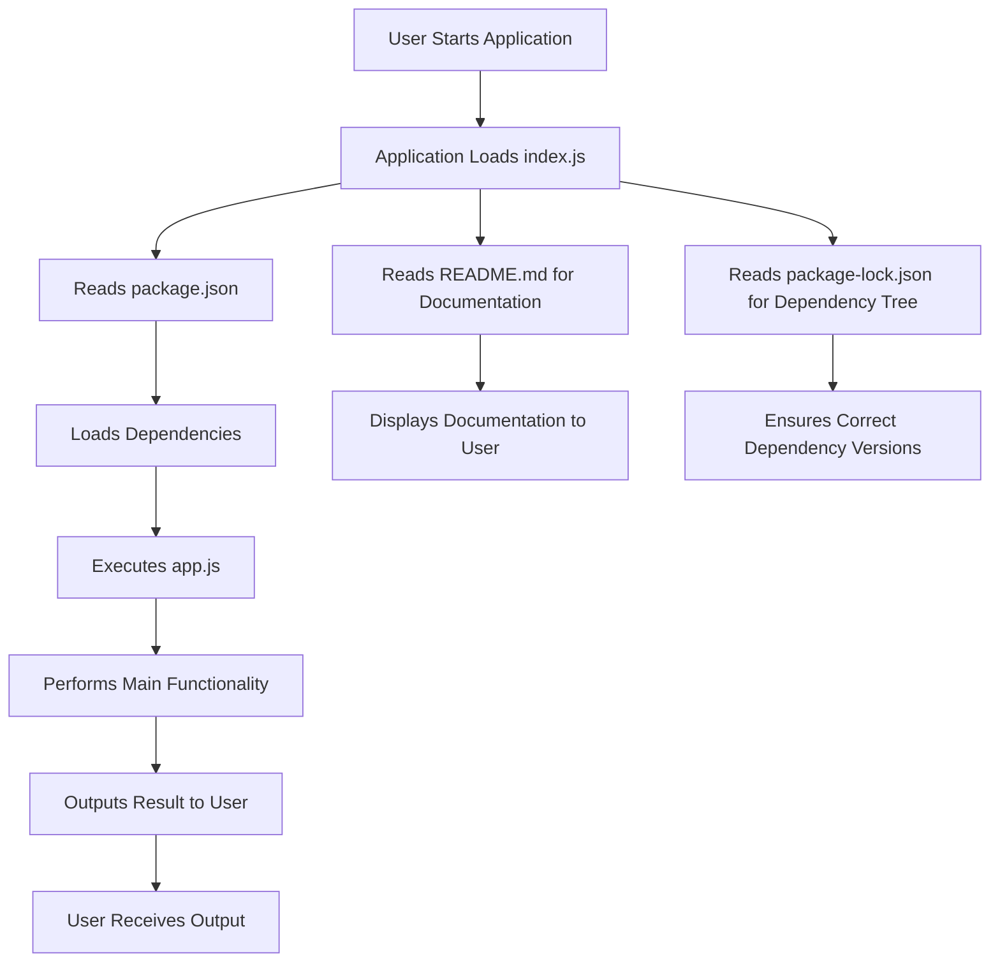

# Architecture Overview

### High-Level Overview
The core logic resides in `index.js`, which utilizes a local database file (`db.js`) to source names and domains. It combines random selections with a number generator to produce unique email addresses.

### Core Concepts
- Random selection from predefined arrays of first names, last names, and domains.
- Integer generation within specified ranges to ensure uniqueness.
- Composition of email string in a standard format.

### Design Decisions
The design emphasizes simplicity and ease of use, providing a single function interface and minimal dependencies.

---

## Architecture Diagrams


### Architecture Diagram 1

```mermaid
graph TD
    A[Root Directory]
    B[README.md]
    C[index.js]
    D[package.json (root)]
    E[package-lock.json (root)]
    F[example/]
    G[example/app.js]
    H[example/package.json]
    I[example/package-lock.json]

    A --> B
    A --> C
    A --> D
    A --> E
    A --> F
    F --> G
    F --> H
    F --> I

    D -->|Defines| C
    D -->|Contains dependencies info| E
    H -->|Defines dependencies for example| G
    H -->|Contains dependencies info| I
```


### Architecture Diagram 2




